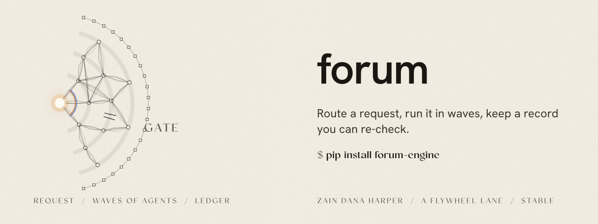

<picture>
  <source media="(prefers-color-scheme: dark)" srcset="docs/art/hero-dark.svg">
  
</picture>

# forum

Hand a request to a team of AI agents, run their tasks in order, and keep a record of every step that you can check later.

```bash
pip install forum-engine
```

[](https://pypi.org/project/forum-engine/)
[](https://github.com/HarperZ9/forum/actions/workflows/ci.yml)
[](LICENSE)


Forum is a Python command-line tool and library for multi-agent runs. You give it a plain request. It picks the kind of agent that fits, asks a model to split the request into tasks with dependencies, and runs tasks that do not depend on each other side by side. A model then judges each result, and forum combines the accepted results into one answer. A task that fails its check can move up to a stronger model.

You choose the models. Any command that reads a prompt and prints a reply works, such as `ollama run llama3` or an agent CLI like `claude -p`. Forum also talks to any OpenAI-compatible chat server and to the Anthropic API, and it can send cheap and hard tasks to different models.

Each step lands in a ledger on disk where every entry carries a hash of the one before it. You can list the ledger, replay it to an earlier point, and follow the chain of steps that led to an answer. `forum ledger verify` reports an edited, dropped or reordered entry. A passing check covers the record only. The run brief has its own line for checks on the answer.

Forum suits developers who run agent pipelines on their own machine or server and want to see afterwards which model did each task and why one was retried. The runtime uses only the Python standard library.

The PyPI package is `forum-engine`. The name `forum` on PyPI belongs to an unrelated project. `forum-engine 1.17.0` is the current source version, published on [PyPI](https://pypi.org/project/forum-engine/1.17.0/) and [GitHub Releases](https://github.com/HarperZ9/forum/releases/tag/v1.17.0).

[Project Telos](https://harperz9.github.io) | [gather](https://github.com/HarperZ9/gather) | [crucible](https://github.com/HarperZ9/crucible) | [index](https://github.com/HarperZ9/index) | [forum](https://github.com/HarperZ9/forum) | [telos](https://github.com/HarperZ9/telos) | [learn](https://github.com/HarperZ9/learn) | [emet](https://github.com/HarperZ9/emet) | [buildlang](https://github.com/HarperZ9/buildlang)

## Install and quickstart

The commands below were run in a fresh virtual environment with `forum-engine` 1.17.0 from PyPI. Python 3.11 or newer is required.

**1. Route a request.** No model and no network needed.

```console
$ pip install forum-engine
$ forum route "build the auth endpoint and the database schema"
{
  "decided": "backend",
  "confidence": 0.6,
  "needs_escalation": false,
  "router": "lexical",
  ...
}
```

**2. Run a whole request without a model.** `--cmd` takes any command. Forum adds each prompt as the last argument and reads the reply from standard output. To watch the pipeline with no model installed, save this stand-in as `stub_model.py`. It answers the planning and judging prompts with fixed JSON and echoes everything else:

```python
import json, sys
prompt = sys.argv[-1]
if prompt.startswith("You are a planner"):
    print(json.dumps({"tasks": [
        {"id": "T1", "agent": "backend", "instruction": "design the login endpoint", "depends_on": []},
        {"id": "T2", "agent": "backend", "instruction": "write tests for it", "depends_on": ["T1"]},
    ]}))
elif prompt.startswith("Judge whether"):
    print(json.dumps({"ok": True, "score": 1.0, "reason": "stub accepts"}))
else:
    print("stub answer for: " + prompt.splitlines()[0][:70])
```

Pass the script by its full path. Forum starts each command in a new empty folder, so a relative path will not resolve.

```console
$ forum submit "ship a login API" --cmd "python /full/path/to/stub_model.py"
checkpoint: 3d21435fb668d311...
stub answer for: Combine the task results into one clear answer to the request.
$ forum ledger show --limit 20
    0  client       request    parent=None
    1  router       route_frame parent=0
    2  dispatch     plan       parent=0
    3  dispatch     task       parent=2
    4  backend      result     parent=3
    5  dispatch     task       parent=2
    6  backend      result     parent=5
    7  validator    verdict    parent=4
    8  validator    verdict    parent=6
    9  synthesizer  result     parent=0
   10  delivery     delivery_check parent=9
   11  delivery-profile delivery_profile_check parent=9
   12  intent       intent_check parent=9
$ forum ledger verify
{
  "chain": true,
  "deep": true
}
$ forum ledger room --brief
...
- Tasks: 2 total, 2 with results, 2 accepted
- Answer: present
- External verification: none ran (an intact ledger is not answer acceptance)
```

The ledger goes to `./forum-ledger`. Pass `--ledger <dir>` to put it elsewhere, or a path ending in `.db` for SQLite.

**3. Watch it catch a tampered record.** From a clone, with no install and no model:

```bash
git clone https://github.com/HarperZ9/forum
cd forum
python examples/demo.py
```

The demo edits one stored result after the run. The quick chain check still passes. The deep check re-hashes every stored body and fails. The full output is under [A worked example](#a-worked-example-catch-a-tampered-record).

**What a real run needs.** Swap the stub for a model:

- a local model: install [Ollama](https://ollama.com), run `ollama pull llama3`, then pass `--cmd "ollama run llama3"`
- an OpenAI-compatible server: `--chat-url http://localhost:11434/v1/chat/completions --model llama3`
- the Anthropic API: `--api` with `ANTHROPIC_API_KEY` set; your provider bills these calls

The quickstart above ran on the stub only. The model-backed paths were outside that run. When a model returns a plan that holds no JSON, `forum submit` stops with `submit failed: no JSON object in output` and exit code 1; small local models do this more often.

## Limits

- By default the model that runs a task also judges it. Forum records each verdict and which model gave it, and a model grading itself is still a weak check. For an independent check, plug a separate verifier into the `VerifierProvider` seam ([crucible](https://github.com/HarperZ9/crucible) is one).
- Approval gates and resume run through the Python API. The CLI, the HTTP daemon and the MCP server can list and resolve gates, but none of them starts a gated or resumable run yet.
- Routing is lexical by default: it scores your words against 28 built-in agent profiles. The opt-in `--router decision` mode can decline to route. On a 74-request held-out set it raised top-1 accuracy from 0.46 to 0.58 and abstained on 19% of requests.
- `--max-model-calls` is enforced. `--max-seconds` is best-effort.

## How it compares

- **LangGraph, CrewAI, AutoGen.** These are the common Python frameworks for multi-agent apps. They have far larger ecosystems, built-in tool calling, and many integrations. Forum has no tool-calling loop of its own; each task is a prompt sent to a model, or to an agent CLI that brings its own tools. What forum adds is a stdlib-only runtime, routing that needs no model, and a ledger you can verify and replay offline.
- **LangSmith, Langfuse, OpenTelemetry tracing.** These record what an agent did and give you dashboards and search. Forum's ledger has no hosted UI. `forum import-trace` reads a LangSmith, OpenTelemetry, AgentOps or generic JSON trace and turns it into a hash-chained record, so a trace from another framework can be checked for edits too.
- **One agent CLI on its own.** If a single model call or one Claude Code or Codex session does the job, forum adds overhead. It pays off when a request splits into several tasks, when different tasks should go to different models, or when you need a record of the run afterwards.

## Inspect and serve

```bash
forum serve --chat-url http://localhost:11434/v1/chat/completions --model llama3
forum mcp --cmd "ollama run llama3"
```

Use `forum status --json` and `forum doctor --json` to inspect the local
installation, then `forum serve` or `forum mcp` to expose the same routing,
ledger, gate, campaign, context, runtime, and prose-contract operations to an
HTTP or MCP host. `forum serve` requires a bearer token by default and prints one
at startup; pass `--no-auth` only on loopback.

Coming from 1.14? Read [Upgrading from 1.14](CHANGELOG.md#upgrading-from-114)
first. Daemon clients now need the token, commands start in an empty folder with
a short environment allowlist, and `forum mcp` offers the gate decision tools
only with `--allow-gate-decisions`.

`forum --help` lists the full surface: `status`, `doctor`, `demo`, `clarify`, `route`, `submit`, `serve`, `mcp`, `context`, `runtime`, `ledger`, `gate`, `campaign`, `import-trace`, `grade`, `export-gradable`, `mine`, `bench`, and `bench-deep-verify`. `import-trace` folds an external trace into a checkable ledger, `grade` and `export-gradable` score and export a run record, and `mine` pulls examples from the ledger. Those four are CLI-only; the MCP server does not expose them. From a source checkout the same CLI is available as `python -m forum`. See [RUNNING.md](RUNNING.md) for real-model setups and [USAGE.md](USAGE.md) for the full command reference.

## Features

- **One command, three model backends.** `forum submit "ship a login API" --cmd "ollama run llama3"` plans the request, runs it across agents, and returns one combined answer. Swap `--cmd` for `--chat-url` (any OpenAI-compatible server) or `--api` (Anthropic). A local CLI needs no account.
- **Model tiers.** Send task agents to cheap, capable, and frontier models by tier: `--cheap-cmd`, `--capable-cmd`, `--frontier-cmd`, or per-tier chat endpoints. Put the whole policy in a TOML file and load it with `--runtime-config`; `forum runtime inspect` explains the merged policy before anything runs.
- **Crash-safe runs.** Runs checkpoint at wave boundaries, and the Python API resumes them from the ledger on disk, reusing every task already recorded as successful and re-running only the rest.
- **Human approvals.** Pause a run at a wave boundary until you approve, edit, or reject it: `forum gate list / approve / edit / reject`. Gates can carry deadlines with a recorded automatic decision on expiry, so an unattended run does not stall silently. See [docs/GATE-DEADLINES.md](docs/GATE-DEADLINES.md).
- **Campaigns.** Declare a multi-project campaign as a JSON feature graph, then drive it until no work is left: `forum campaign declare / status / next / run / ingest-status`. Cycles are caught up front; external project status can be ingested without execution.
- **Run and context budgets.** `RunBudget` caps a run by model calls and wall clock. `ContextBudget` admits, trims, or omits request context, per-task context, upstream injection, and synthesis inputs under approximate-token caps. `forum context preflight` estimates the pressure before you spend a model call.
- **Codex route-preflight skill.** A standalone ZIP lets Codex hosts preview Forum route, context pressure, runtime readiness, and the prose contract before spending model calls. The helper only advises and never submits work. See [below](#codex-route-preflight-skill-asset).
- **Answer checks.** A deterministic length check flags verbose answers; an opt-in reviser tightens them, accepted only if the shorter version still covers the request. Delivery profiles (`operator`, `engineer`, `researcher`, `executive`) check the final answer against a local style contract, picked from the route by default.
- **Routing without a model.** `forum route` picks a route from a 28-route default roster without a model, and attaches a `forum.route-frame/v1` frame: domain, intent, posture, delivery profile, runtime tier, and the style contract the final answer follows.
- **Escalation on record.** Every result records the model that produced it. A failed task moves up a ladder of stronger models, and the failing verdict that caused the move is in the ledger.
- **Trace import.** `forum import-trace trace.json --format langsmith` (or `otel`, `agentops`, `generic`) turns another tool's trace into a hash-chained ledger and reports whether it verifies.
- **HTTP and MCP.** One daemon (stdlib asyncio, no framework) serves the engine over HTTP; `forum mcp` exposes the same tools over MCP (stdio), a thin adapter over the HTTP surface so the two cannot drift.
- **Run briefs and capsules.** `forum ledger room --brief` turns the latest run into a readable brief with state, risk, and next actions. `forum ledger capsule` compacts a run into a reusable context brief for the next one.
- **Zero dependencies.** Pure standard library at runtime. Python 3.11+.

## See it work, step by step

The [animated explainer](https://harperz9.github.io/repo-explainers/forum.html)
walks through the bundled demo: four requests routed with no model, a four-task graph planned into waves, execution with causal links, ledger verification and a tampered payload body that only the deep verify catches. Every value on it is output from this repository. Its
source is [docs/explainer/index.html](docs/explainer/index.html).

## Watch

[](https://harperz9.github.io/explainers.html#rederive-h)

**[Re-derive it. Don't take it on trust.](https://harperz9.github.io/explainers.html#rederive-h)** (2 min 5 s, narrated, captioned). Forum's ledger can be replayed and verified after the run, the practice this film describes. The film page carries the transcript, the sources and recall questions.

## Codex route-preflight skill asset

The skill ships two ways. The GitHub release [`forum-route-preflight-v0.1.0`](https://github.com/HarperZ9/forum/releases/tag/forum-route-preflight-v0.1.0) carries `forum-route-preflight-skill-20260907-final.zip`, which you can download and extract without cloning this repository or installing the engine. The `forum-engine` package also carries the same files at `forum/skills/forum-route-preflight/`, with `forum/skills/forum-route-preflight.sha256` holding the hashes of the four reviewed files; the 1.17.0 wheel includes them. The standalone ZIP does not publish to PyPI and does not change the package version.

The skill was validated against the `forum-engine==1.13.0` CLI/API shape. It previews route, context pressure, runtime readiness, and delivery-profile prose checks; it keeps `decision.safe_to_submit: false`, never calls `forum submit`, and never runs the configured model command. Failed subprocess diagnostics in its shareable report contain only exit code, byte counts, and SHA-256 digests of raw diagnostic bytes. Successful JSON is scrubbed for exact helper-supplied task text, paths, runtime commands, chat URLs, model names, API-key environment variable names, and the current values of those supplied API-key variables. It is not a universal secret detector for transformed or previously unknown values.

See [USAGE.md](USAGE.md#codex-route-preflight-skill-asset) for download, extraction, and checksum commands.

## How a run works

`forum submit` turns one plain request into one answer, and leaves behind a
record of everything that produced it. This is the path a request takes.

<p align="center"></p>

The edge that loops back is escalation, and what makes it auditable is where it
starts. A task does not climb to a stronger model because a model reported low
confidence. It climbs because a judge wrote a verdict into the ledger, that
verdict said the result failed, and the retry is chained to it. Read the record
later and the reason a frontier model was spent is right there as an entry, not
an inference.

The band at the bottom is the part worth reading twice. `forum ledger verify`
reports two booleans, not one: the chain recomputes, and the stored bodies still
hash to their keys. They can disagree. A body that was redacted down to its
fingerprint is skipped by the deep pass rather than failed, which is what makes
hash-only storage usable, and it is also the reason a green deep check is not a
claim that every payload was examined. It is a claim about the ones that are
still there.

## What a tight budget does to context

`ContextBudget` caps how much text one run may carry, per source and in
total. When a cap binds, something has to give. What a task actually ends
up seeing is the question this answers.

<p align="center"></p>

Every piece leaves a row behind, dropped ones included. `forum context
preflight` runs the same arithmetic on the same inputs before a model call
is spent.

## A worked example: catch a tampered record

No install needed beyond a clone, and no model is called:

```bash
git clone https://github.com/HarperZ9/forum
cd forum
python examples/demo.py
```

The demo routes a few requests, plans a dependency graph into parallel waves, runs it, and then quietly corrupts one stored result:

```
4. Accountability: verify, tamper-detect, replay
  verify() (chain)      : True
  verify(deep=True)     : True
  causal chain of last  : request -> plan -> task -> result

   ...now tamper with a stored payload body (seq 2)
  verify() (chain only) : True   <- chain hashes still link
  verify(deep=True)     : False  <- body tamper caught
```

The chain of hashes still links, so a shallow check passes. But one record's contents no longer match what was promised, and the deep check says so. A visual replay of the same ledger lives at [`examples/forum-demo.html`](examples/forum-demo.html).

Every example in [`examples/`](examples/) is a short, offline, dependency-free demonstration of one capability: escalation ladders, intent judging, delivery tightening, crash resume, context pressure, context capsules, campaigns, and more.

## How the ledger works

Two old ideas do most of the work. A hash chain: every entry carries a fingerprint of the one before it, so edits, drops, and reorders stop the fingerprints lining up, and `verify()` tells you where. Content addressing: prompts and outputs are stored under a fingerprint of their own bytes, which keeps the chain small and lets you redact a sensitive body down to its fingerprint with the chain still checking out; `verify(deep=True)` re-hashes each body that is present.

Everything else falls out of those two. `replay(until=...)` rebuilds the exact state at any past point. `causal_chain(seq)` follows parent links to answer why something happened. `checkpoint()` folds the history into one Merkle root, built to avoid the second-preimage collision (CVE-2012-2459) that naive Merkle code runs into. By default the ledger lives in memory; point it at `FileStorage` and every entry is appended to a JSONL file and fsynced before the next, so the record survives a restart, tolerates a crash-torn final write, and still verifies exactly.

To measure the scaling cost honestly, `forum bench-deep-verify` builds deterministic ledgers and times chain-only `verify()`, payload-only `verify_payloads()`, and full `verify(deep=True)` separately. It varies entry count, payload body bytes, storage mode (`memory`, `file-sync`, `file-batched`), and redaction ratio, then emits a `forum.deep-verify-benchmark/v1` JSON receipt:

```bash
forum bench-deep-verify --entries 1000,10000 --payload-bytes 256,4096 --storage memory --storage file-batched --json
```

## HTTP and MCP surfaces

The daemon exposes route, plan, submit, clarify, prose contracts, gates, run rooms, capsules, runtime inspection, context preflight, and ledger verify/replay over HTTP (`/route`, `/plan`, `/submit`, `/gates`, `/gate/approve`, `/room`, `/capsule`, `/runtime`, `/context/preflight`, `/clarify`, `/prose/contract`, `/verify`, and more). MCP mirrors the same tools: `forum.submit`, `forum.route`, `forum.status`, `forum.doctor`, `forum.prose.clarify`, `forum.prose.contract`, `forum.ledger.summary`, `forum.ledger.capsule`, `forum.run.room`, `forum.runtime.inspect`, `forum.context.preflight`, plus `plan`, `verify`, `ledger_get` and `gate_list`. That is 19 tools in 1.17.0, counting the short aliases `route`, `status`, `submit` and the deprecated `forum.prose.humanize`. `gate_approve`, `gate_edit` and `gate_reject` appear only when the server starts with `--allow-gate-decisions`. Calls also accept the dotted names `forum.plan`, `forum.verify`, `forum.ledger.get` and `forum.gate.*`.

## Latest release

The latest release is `forum-engine 1.17.0`. It adds opt-in decision routing
(`forum route --router decision`), which scores every lane and abstains below a
threshold. On a 74-request held-out set it raised top-1 accuracy from 0.46 to 0.58,
and its 19% abstain rate misses the 15% bar set before the run. The release also
renames `humanize` to `clarify` with an optional Articulate handoff, and keeps the
1.16.0 Windows client packages and preflight-only MCP surface. See [CHANGELOG.md](CHANGELOG.md) for the
release history. CI runs the full test suite and ruff on every push.

## Docs

- [docs/INTRODUCTION.md](docs/INTRODUCTION.md): what forum is, core concepts, and a first-ten-minutes walkthrough.
- [ARCHITECTURE.md](ARCHITECTURE.md): the layers, the ledger, and the surfaces.
- [RUNNING.md](RUNNING.md): run it against a real model, over the API or a model CLI.
- [USAGE.md](USAGE.md): the full command reference.
- [docs/GATE-DEADLINES.md](docs/GATE-DEADLINES.md): human-in-the-loop gates with durable deadlines.
- [docs/ENTERPRISE-READINESS.md](docs/ENTERPRISE-READINESS.md): context envelopes, action receipts, and host-neutral operation.
- [SECURITY.md](SECURITY.md): the trust model, the no-shell guarantee, and sandboxing.

Peer projects in Project Telos compose through clean seams: [index](https://github.com/HarperZ9/index) supplies organized context through the `ContextProvider` seam, and [crucible](https://github.com/HarperZ9/crucible) can check answers through the `VerifierProvider` seam. Both default to no-ops, so forum stands alone.

## Why it matters

Agent runs are hard to debug after the fact: a log tells you what was printed, and it can be edited without a trace. forum writes every routing decision, task, result, and verdict into a hash-chained, content-addressed ledger. You can verify it, replay it to any point, and follow the chain of steps behind an answer.

## License

Forum is fair-source: the code is open to read, run, and build on, with commercial use reserved so the project can fund its own development. Copyright stays with the author. See [LICENSE](LICENSE) for the exact terms.

## For developers

Keep the public README, package metadata, and examples aligned with current behavior. Before opening a PR or pushing a release:

```bash
python -m pip install -e ".[dev]"
python -m pytest
python examples/demo.py
```

## What this believes

This tool is one lane of a family that holds a single belief steady across
every surface: knowledge open to anyone who can attain the means; acceptance
decided by external checks, never reputation; every result re-runnable;
honest nulls first-class; ownership earned by comprehension; learning woven
into the work. The full text lives in [CREDO.md](CREDO.md).
The long form of this belief: [The Unbundling](https://github.com/HarperZ9/flywheel/blob/main/docs/essays/2026-07-13-the-unbundling.md).

---

Built by **[Zain Dana Harper](https://harperz9.github.io)** in Seattle: evidence-first tools that leave a re-checkable artifact behind. The full workbench is at [Project Telos](https://harperz9.github.io).

The current published release is `forum-engine 1.17.0`.

## Local client packages

The [1.17.0 release](https://github.com/HarperZ9/forum/releases/tag/v1.17.0)
includes native Windows ZIP and MCPB client packages. Marketplace acceptance is
not established by publication of these archives.

### Installation

See [the client package guide](client-plugin/README.md) for scoped skills, portable MCP configuration and same-release archives.
